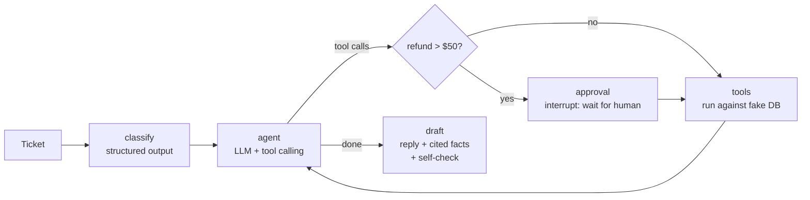

# 🎫 Support-Ticket Triage Agent

**Live demo:** _deploying on Streamlit Community Cloud, link coming_  ·  **Stack:** LangGraph · Groq (`openai/gpt-oss-120b`) · Streamlit · pytest

An AI agent that handles a customer-support ticket the way a junior support rep would:

1. **Classifies** it (billing / refund / shipping / technical / account / other) and its urgency.
2. **Extracts** the order id, email and product.
3. **Calls tools** (`get_order`, `get_customer`, `issue_refund`) against a small fake database.
4. **Stops and asks a human** before any refund over **$50** (LangGraph `interrupt`).
5. **Drafts a reply** that cites the facts it used, e.g. `[1] get_order(ORD-1002): status = delivered`.

It ships with a **102-ticket labelled eval set** and a script that measures routing accuracy, tool-call accuracy, approval correctness, latency and cost. All numbers below come from that script.

## Results (measured)

One run of `python eval/run_eval.py` with `openai/gpt-oss-120b` (temperature 0, `reasoning_effort=low`) on 2026-10-25.

> ⚠️ **Partial run: 81 of 102 tickets scored.** Groq's free tier allows 200,000 tokens per day for this model. The run used it up at ticket 82, so the last 21 tickets (13 *account* and all 8 *other*) failed with a rate-limit error. They are **excluded** below, not counted as wrong. The 81 scored tickets cover refund (31), shipping (18), billing (15), technical (15) and account (2). To score the rest once the quota resets: `python eval/run_eval.py --rerun-errors`.

| Metric (81 scored tickets) | Result |
|---|---|
| Routing accuracy (category) | **100.0%** (81/81) |
| Tool-call accuracy (right tools **and** right arguments) | **95.1%** (77/81) |
| Refund-approval gate correct (paused iff refund > $50) | **100.0%**: 12/12 paused, 0 false pauses |
| Order-id extraction / email extraction | 100.0% / 98.8% |
| Urgency accuracy | 81.5% (66/81) |
| Latency per ticket | avg **3.27 s**, p50 3.10 s, p95 5.42 s |
| LLM calls per ticket | 4.23 avg |
| Tokens per ticket | 2,642 in + 453 out (avg) |
| Cost per ticket at Groq list price | **≈ $0.00067** (free on the free tier) |

**Where it got things wrong (all 81 rows are in `eval/results/results.jsonl`):**

- **Tool calls (4 misses).** In 2 tickets that gave both an order id and an email, the agent skipped `get_customer`. The policy says to look up every email, probably because `get_order` already gave it what it needed. In 1 such ticket it also didn't issue a valid $19.99 refund. In 1 ticket it misread an email (`priyaa.singh@…`), so the lookup missed.
- **Urgency (15 misses).** These are mostly disagreements with my own rule-based labels, not clear model errors. 8 polite refund requests that I labelled *low* were rated *medium*, and 5 "my statement doesn't match the price" billing tickets that I labelled *medium* were rated *low*. Real triage would need labels from real support staff.

**Live demo vs. eval:** the eval uses only `gpt-oss-120b`. The live demo falls back to `openai/gpt-oss-20b` when the 120b daily quota is used up, and shows which model answered. The 20b model was **not** evaluated. In a spot check it handled the approval flow correctly but did not add inline `[1]` citations to the reply.

## How it works



| Node | What it does |
|---|---|
| `classify` | One LLM call with a JSON-schema structured output (`Triage`): category, urgency, entities, summary. |
| `agent` | The LLM gets the three tools and a written refund policy, and decides which tools to call. It loops with `tools` until it stops calling tools (max 4 turns). |
| `approval` | If any `issue_refund` call is over $50, the graph **pauses** with `interrupt()`. The state is saved by a checkpointer; the UI shows Approve / Reject and resumes with `Command(resume=...)`. |
| `tools` | Runs the calls against `triage/store.py`, a JSON-backed fake DB. Refunds are validated there too (order must be delivered, amount ≤ refundable). |
| `draft` | Writes the reply as structured output (`reply` + `cited_facts`). A **self-check** in code rejects a reply that claims a refund when none was issued and retries once. |

**Design choices worth noting**

- **The $50 rule is enforced in code, not in the prompt.** The router checks the tool call's `amount`, so the LLM cannot talk its way past the human.
- **The refund outcome is computed in code** and given to the drafting step as an authoritative fact. During development the model sometimes wrote "I've initiated a refund" for orders that were never refunded. Passing the outcome explicitly plus the self-check fixed that in my manual tests.
- **Each eval ticket gets a fresh copy of the database**, so one ticket's refund can't affect another.

## The eval

- `scripts/make_data.py` builds the fake store (25 customers, 60 orders) and **102 tickets from hand-written templates**. Because tickets are generated from templates, every label (category, urgency, expected tool calls with arguments, whether approval is needed) is known by construction. It is seeded, so it regenerates byte-for-byte.
- The set includes tricky refund cases: refunds that **must not** be issued (order not delivered yet, already refunded, unknown order id, asking for more than the order total), partial refunds, and tickets that contain both an order id and an email.
- `eval/run_eval.py` runs every ticket, auto-approves every pause, and scores:
  - **Routing accuracy**: predicted category == label.
  - **Tool-call accuracy**: the *set* of tool calls (name + normalised arguments, including the refund amount) exactly equals the expected set. Any missing, extra or wrong-argument call fails the ticket.
  - **Approval-gate correctness**: the agent paused **if and only if** the expected refund was over $50.
  - **Latency**: wall-clock time per ticket (client-side rate-limit waiting is excluded).
  - **Tokens / cost**: from the API's usage data, priced at Groq's list price for gpt-oss-120b ($0.15 / 1M input, $0.60 / 1M output, checked 2026-10-25). On the free tier the actual cost is $0.
- Per-ticket results are in [`eval/results/results.jsonl`](eval/results/results.jsonl) and the summary is in [`eval/results/summary.json`](eval/results/summary.json).

## Limitations (honest)

- **Synthetic, template-based data.** Real tickets are messier (several issues in one ticket, typos, threads, other languages). The scores show how well the agent follows the policy on clean inputs; they are not a production estimate.
- **Urgency labels are rule-based** (my rules, written into the prompt), so urgency accuracy measures rule-following, not real-world priority.
- **Mock tools.** Nothing touches a real payment system. The refund policy is deliberately simple.
- **One run, temperature 0.** I did not measure run-to-run variance.
- **Free-tier rate limits.** On Groq that's 8K tokens a minute and 200K tokens a day per model, about 65 tickets a day on gpt-oss-120b. The demo can be slow, fall back to the smaller model, or briefly fail when several people use it.
- **The eval is incomplete** (81/102, see above), and the account/other categories are barely covered so far.
- The draft self-check is a regex heuristic; it only guards against one specific failure (claiming a refund that didn't happen).

## Run it locally

```bash
python -m venv .venv
.venv\Scripts\activate            # Windows  (source .venv/bin/activate on macOS/Linux)
pip install -r requirements-dev.txt
copy .env.example .env            # then put your free Groq key in .env
streamlit run app.py
```

```bash
pytest -q                          # unit tests (the LLM is mocked, no API key needed)
ruff check .
python scripts/try_one.py "Order ORD-1002 arrived broken, refund please"
python eval/run_eval.py --limit 10 # small eval run; the full run needs ~315K tokens, more than one day of free quota
```

## Project layout

```
triage/graph.py     LangGraph nodes, routing, HITL interrupt, draft self-check
triage/store.py     fake order/customer DB + refund validation
triage/prompts.py   system prompts (classification rules, tool policy, reply rules)
triage/schemas.py   Pydantic models for structured output
app.py              Streamlit UI
eval/               labelled tickets + eval runner + results
scripts/            data generator, one-off CLI
tests/              pytest with a scripted fake LLM
```

## License

MIT © 2026 Japan Bhavsar
